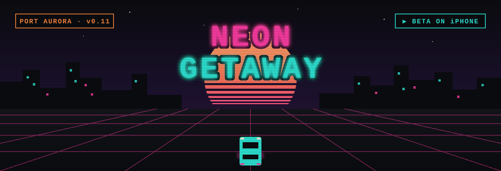
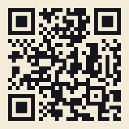
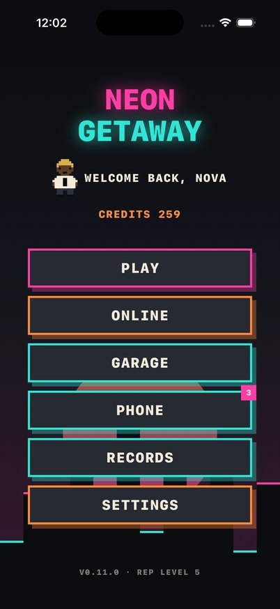
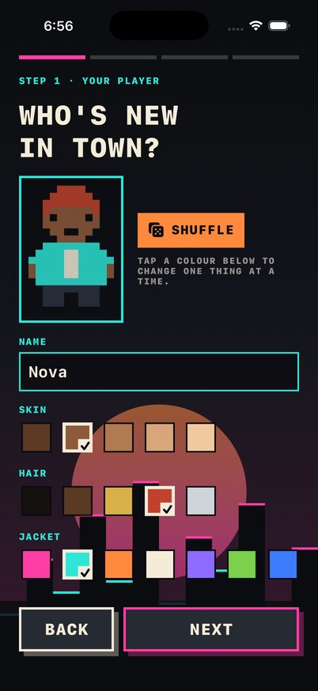
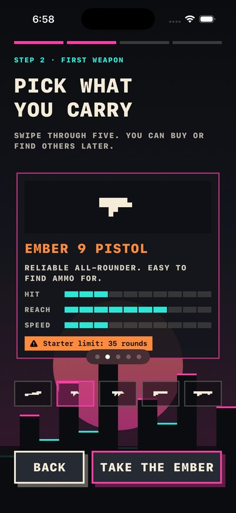
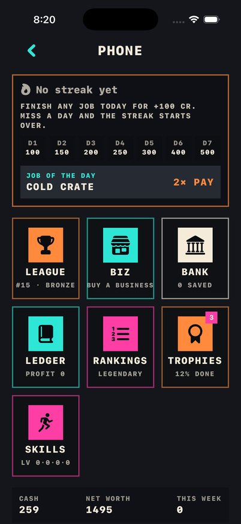
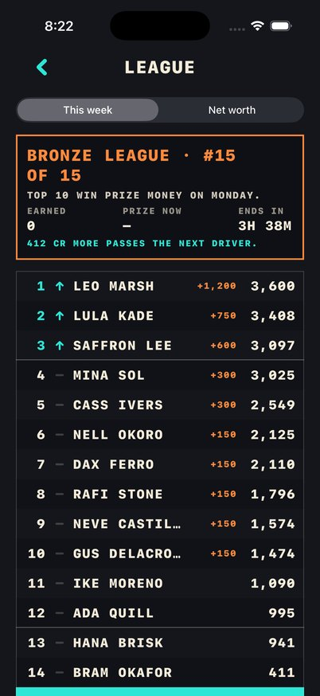
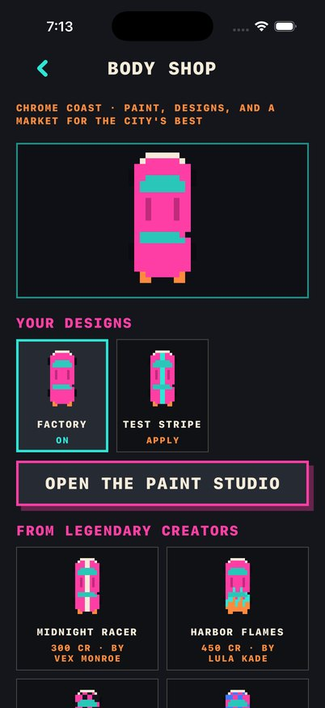

  

  
  
  

<h3 align="center">An original top-down retro open-city game for iPhone. Drive, run, hustle and build a money empire in the neon coast city of Port Aurora.</h3>

---

## 🕹️ Get in the car: join the beta

> **Heads up:** the beta link is live, but Apple still has to approve the first beta build for outside testers. If TestFlight says *"This beta isn't accepting any new testers right now"*, Apple hasn't approved it yet. Try again in a day or two.

<table>
<tr>
<td width="62%" valign="top">

**1. Get TestFlight.**&nbsp; Install Apple's free [TestFlight app](https://apps.apple.com/app/testflight/id899247664) from the App Store on your iPhone.

**2. Open the invite.**&nbsp; On that iPhone, tap 👉 **[testflight.apple.com/join/D5zuDQmg](https://testflight.apple.com/join/D5zuDQmg)**, or scan the code with the Camera app.

**3. Accept, then Install.**&nbsp; TestFlight opens. Tap **Accept**, then **Install**. Neon Getaway lands on your Home Screen with an orange dot (that just means it's a beta).

**4. Hit the streets.**&nbsp; Make your player, pick your first weapon, and take your first job.

</td>
<td width="38%" align="center" valign="middle">
   
  <b>Scan to join</b> · iPhone, iOS 17 or later
</td>
</tr>
</table>

## 🎯 Your mission, tester

Play however you like, but these are the runs we most want reports on:

| # | Try this | Tell us |
|:-:|---|---|
| 1 | **Your first three jobs:** *Cold Crate*, *Tide Line Run* and *Lantern Sweep* | Too easy, fair, or too hard? |
| 2 | **Steering and drift** in a car, then on a motorcycle | Does it feel good? Are the controls the right size? |
| 3 | **Get chased.** Pick up some heat and shake the Harbor Patrol | Fair, too aggressive, or too easy to lose? |
| 4 | **Phone → League, Bank, Biz:** buy the taco truck and collect its till later | Did the money system make sense? |
| 5 | **Garage → Body shop:** paint a car, or design your own in the paint studio | Fun? Confusing? |
| 6 | **Online:** sign in to Game Center, check the leaderboards, then tap **Find players** with a friend | Did you find each other? Any lag? |

## 📣 Sending feedback (takes 10 seconds)

- **Screenshot it:** take a screenshot in the game, tap the little preview, then tap **Done → Share Beta Feedback**, add a note and send. It comes straight to us with your device info.
- **Something crashed?** Next time you open the app, TestFlight asks if you want to share what happened. Please say yes and add a line about what you were doing.
- **Long story or idea?** Open the TestFlight app → Neon Getaway → **Send Beta Feedback**, or email **hello@phoronomicstudios.com**.

Useful things to include: which job or screen you were on, what you expected, and what happened instead.

## 📸 A look around Port Aurora

  
  
  
  
  
  

## 🏁 Street Challenge (new in v0.14)

Every week Port Aurora gets a new time-trial route: five checkpoints in order, starting at the Safehouse. You race two see-through ghost cars:

- **Nova** (magenta): the game's own driver, run through the same physics. Beat Nova's time for **gold**, finish within 20% for **silver**, finish at all for **bronze**. Each medal pays a bonus once a week.
- **Your best** (teal): your fastest run this week, so you can see exactly where you lose time.

Find it at the top of the job map (**Race the ghosts**), or from the Online screen when nobody else is around. A new route starts every Monday (UTC).

## 🎮 Controls cheat sheet

**Turn your phone sideways:** free roam and jobs play in landscape (menus stay upright).

| | In a car (Racer, default) | On foot |
|---|---|---|
| **Left thumb** | Joystick: push where you want to drive (pull back to reverse) | Stick: run the way you point · a second FIRE above it |
| **Right thumb** | DRIFT · BRAKE pedal · GAS pedal | Big FIRE / SWING · AIM (hold to lock on and face the nearest target while you keep running) · SWAP weapon · SPRINT (uses stamina) |
| **Bottom middle** | | Weapon bar (tap a weapon to hold it) · AUTO FIRE (shoots cruisers in your sights for you) |
| **Context button** | GET OUT · KEEP CAR (in the Safehouse bay) | GET IN · SHOP |
| **Controller** | Left stick steers · triggers gas/brake · B drifts · A gets in or out · Y switches weapon | Left stick runs · left trigger aims · right shoulder fires · B sprints |

Car buttons are drawn at 65% opacity so the road shows through them. Change that, the button size and their positions, or switch to **Stick** (point where you want to drive) or **Classic** (steering strip and pedals) in **Settings → Customise touch controls**.

## 🧾 The rules of the street

- **Cartoon action, 13+.** People who get knocked down fade out and walk back in. No blood.
- **No ads, no purchases.** Everything is earned with in-game credits.
- **Online is safe by design.** No chat, names are filtered, and you can report or block any player or design.
- **Beta builds expire** after 90 days. TestFlight updates you when a new one is ready.

---

<b>🛠️ For developers: build it yourself, how it plays, and the code layout</b>

## Run it

1. Open `NeonGetaway.xcodeproj` in Xcode 26 or later.
2. Pick an iPhone simulator (or your iPhone; signing uses team X6LZQ3FS36) and press Run.

Controls (landscape since v0.13; Racer is the default: the joystick plus GAS/BRAKE pedals in a car, the shooter layout with FIRE, AIM, SWAP, SPRINT, a weapon bar and AUTO FIRE on foot). Stick style: a floating stick on the left points where to go (the car steers and drives that way; pull back to brake and reverse; on foot you run that way), with BRAKE and DRIFT on the right in a car, SPRINT and FIRE on foot. Classic style (Settings): drag the left strip to steer; hold GAS, BRAKE (hold at a stop to reverse) and DRIFT; on foot the strip turns you and RUN and BACK move you. The context button above the pedals says what you can do where you are: GET IN, GET OUT, SHOP (in the gun store) or KEEP CAR (in the Safehouse bay).

## How it plays

- **Jobs:** three open from the start, then one harder job per reputation level (numbered pins on the map; locked ones show a padlock and the level they need):
  1. *Cold Crate*: Pier 9 → Lantern Alley in 35 s.
  2. *Tide Line Run*: start hot (2★) in the Customs Yard, lose the heat, then reach Pier 4.
  3. *Lantern Sweep*: grab three lanterns in any order, then get home to the Safehouse in 60 s.
  4. *Deep Freeze* (rep 1): Pier 4 → the Neon Row bay in 25 s, starting at 1★.
  5. *Ghost Tide* (rep 2): start at 3★ on Harbor Avenue, lose the heat, then reach Pier 9.
  6. *Lantern Festival* (rep 3): five lanterns, 14 heat each, then home in 80 s.
  7. *Double Cross* (rep 4): a 20 s drop at Pier 9 that turns out to be a setup (+55 heat and a dispatch fix), then an untimed escape to the night-market lane. The speed bonus only counts the drop.
- **Heat:** 0–100 points shown as 0–5 stars, a label and a number. Crashes, ramming a patrol, the Customs Yard and lantern grabs add heat. It cools 8 points a second after 4 s out of every patrol's sight; the Safehouse clears it. Gaining a star, or starting a job hot, puts dispatch on your position for a few seconds.
- **Harbor Patrol:** two cruisers always on the streets, up to five as heat rises. Each sees in a cone ahead (shown on the road) and chases, searches the last-seen spot, then gives up. Stop next to a chasing cruiser for 3 s and you're busted.
- **Hull:** hard crashes and patrol rams cost hull points; at zero you're wrecked.
- **Garage:** speed, handling and durability, four levels each (150 / 400 / 900 / 1800 credits), opened by reputation level. Upgrades apply to every car you own. Pick which owned car you start in; sell extras (used cars sell for 40% of their value).
- **On foot and rides:** get out anywhere slow enough. Ten parked vehicles wait around the district: Dorado sedans, Ridgeback vans and Flicker 250 motorcycles. Taking one a patrol can see adds heat. Park a street car in the Safehouse bay and tap KEEP CAR to own it (six garage slots). A wrecked vehicle throws you clear instead of ending the run; on foot you have 100 HP, and running out means you're knocked out.
- **Guns:** the Ember 9 pistol, Rattler SMG and Breaker shotgun lie in four spots around the district (they come back after a minute) and are sold, with ammo, at Bolt & Barrel on Signal Street. FIRE auto-aims at the nearest person or cruiser in front of you. Cartoon rules: people hit are knocked flat, fade, and walk back in somewhere else; no blood. Gunfire scatters the crowd, hitting people or cruisers adds heat, and six damage disables a cruiser.
- **Business:** every credit in and out goes in a ledger (job pay, upgrades, weapons, ammo, car sales). The Business screen shows money in, money out, profit, margin, net worth (cash plus cars) and seven short money lessons that unlock from what you do (revenue vs profit, reinvesting, cash vs assets, side hustles...).
- **Onboarding:** first launch walks through five screens: arriving in Port Aurora, making your player (name, skin, hair, jacket, Shuffle), picking a first weapon from five (Slugger bat, Ember 9 pistol, Rattler SMG, Breaker shotgun, Longshot rifle), the street rules, and a resident card. The player's colours show on the street and on the main menu.
- **Starter limit:** a starter gun holds 35 rounds; store ammo only tops it up to 35. The limit comes off with an Extended Mag (250 credits at Bolt & Barrel) or a new copy of the gun: bought (store or the alley dealer, 20% cheaper), found, or dropped by a disabled cruiser, a knocked-down civilian (1 in 4 carry) or the robbed dealer. Drops last 45 s. The bat is melee and never runs out. Taking guns from other live players waits for online play.
- **Workbench (gun builder):** at Bolt & Barrel, every owned gun has three part slots: barrel (Long: +30% reach, slower; Snub: faster, shorter), magazine (Extended: no starter limit, +50% capacity) and grip (Steady: wider auto-aim; Quick: faster fire). Parts cost 180–250 credits once per gun and swap free; eight finish colours (60 credits) tint the gun and its tracers. Stat bars compare stock with built.
- **Body shop and paint studio:** Garage → Body shop. Paint any owned car with a design you own: buy one of six designs from the city's Legendary creators, or draw your own in the studio (12×20 grid stretched over the car body; pen, fill, eraser, mirror, six templates, live preview on any car). Painted cars show on the street.
- **Rankings and the design market:** score = reputation XP + 10 per job + profit ÷ 5, against 14 invented rivals. The top five are Legendary and can list their own designs (50–5,000 credits, up to six). After every finished job, simulated buyers shop: bolder designs sell more, pricier ones fewer (about 3 × boldness × e^(−price/400) a day). The shop keeps a 30% platform fee; the rest is paid straight into the creator's credits and ledger. Three more money lessons: price vs demand, platform fees, make once / sell many times.
- **Weekly league (Phone → League):** 15 drivers per division (Bronze, Silver, Gold, Platinum, Neon), ranked on money earned by working since Monday: job pay, design sales, business profit and daily bonuses (selling things you own, interest and prizes don't count). Rivals earn through the week at their own pace. On Monday the week settles: the top 10 split a prize purse (1st = 4× the division's base: 300 in Bronze up to 2,500 in Neon), the top 3 move up and the bottom 3 move down. A week you sit out changes nothing. The board shows your projected prize, the gap to the next driver and the time left. A Net worth tab ranks cash + savings + what your cars, businesses and guns would sell for.
- **Dailies:** the first job each day pays a streak bonus (100, 150, 200, 250, 300, 400, then 500 a day); miss a day and it starts over. Every 7 days earns a streak shield (max 2) that covers one missed day. One unlocked job a day is the Job of the day and pays its base pay again, once.
- **Harbor Savings (Phone → Bank):** deposit and withdraw any time; 1% a day, compounded, on up to 25,000 (up to 30 days of catch-up). A calculator shows the balance in 7, 30 and 90 days.
- **Businesses (Phone → Biz):** taco truck (1,500), car wash (4,000, rep 1), laundromat (7,500, rep 2), print shop (12,000, rep 3), arcade (20,000, rep 4). Each takes revenue every real hour, even with the app closed, pays supplies, wages and rent out of it (30–45%), and holds the profit in its till for 8 hours (10 and 12 after upgrades). Cards show profit per hour, costs and payback time. Collecting books revenue and running costs separately; buying and upgrading is an investment in the ledger, not an expense. Sell back for 60% of what went in.
- **Skills:** Driving (+3% steering a level), Shooting (+6% auto-aim cone), Stamina (+4% run speed), Hustle (+5% business takings), levels 0–5, earned by driving, running, landing hits and collecting/selling.
- **Trophies:** 25 with progress bars and a credit reward to claim, and a completion percentage.
- **Witnesses and tickets:** a crime a patrol sees adds heat at once. Otherwise the nearest bystander with a clear view (within 380 points) calls it in after 4 s, and patrols head to the scene; with nobody watching, nothing happens. Ditch the ride you were seen in before the call lands and the heat is halved. Caught at 1 star or less, you get a 150-credit ticket (cash first, then savings) instead of being busted.
- **Weather and light:** with live weather on, the street follows your clock: dawn, day, dusk and night tints, and about 3 trips in 10 are in the rain, which makes cars slide more and brake less.
- **Controls and options:** Settings has aim assist (Off, Low, Standard, High), frame rate (30/60/120), and a touch-layout editor (drag the steering and pedal clusters anywhere, size 80–140%, opacity, steer-on-the-right). Game controllers: left stick steers, triggers are gas and brake, B drifts, right shoulder fires, A gets in or out (or shops, deals, keeps the car), Y switches weapon, Menu pauses. Pause → Photo mode hides the HUD to snap and share the street.
- **Online (menu → Online):** everything online needs Game Center; offline, the rest of the game works as before.
  - *Leaderboards:* this week's earnings (a recurring weekly board), all-time score and net worth, posted automatically.
  - *Online design market (Body shop):* every player's published designs from the iCloud public database, with sales counts. Buying writes a purchase record first, then charges credits. Legendary players publish their own designs; their game pays them (minus 30%) for each purchase record it finds, once each.
  - *Safety (App Review 1.2):* no chat; player and design names pass a filter; hold a design to report it (offensive, sexual, copied, other) or block its creator; designs with 3+ reports are hidden for everyone; blocked players' designs and avatars are hidden; a contact link (set `Support.email`).
  - *Live street:* Game Center auto-matches 2–4 players into one free-roam Port Aurora. Each phone runs its own city and sends its player 10×/s; others are drawn smoothed, on foot or in their painted car with a name tag. Shots and car hits on other players are reported to them and checked for range; the player hit applies the damage. A player knocked out by another drops a gun (their best) at their feet and gets up at the Safehouse; the dropper's phone gives it to the first player to claim it, with no starter limit.
- **Street Flyers:** an on-foot side hustle for the Signal Street print shop: four storefronts and back in 90 s.

## Check script

`tools/check.command` (double-click, or run in Terminal) runs the GameCore unit tests, builds for the iPhone Simulator, installs, launches and takes a screenshot. Results land in `Logs/check.txt`, `Logs/swift_test.log`, `Logs/xcodebuild.log` and `Logs/sim_launch.png`. `tools/check_watch.command` runs the check whenever `Logs/check_request` appears. If `Logs/check_args` holds launch arguments (for example `-NGAutoJob coldCrate -NGAutopilot YES`), the check passes them to the app and takes a second screenshot, `Logs/sim_after.png`, about 34 s after launch. Those arguments only work in Debug builds: the first opens a job directly (`coldCrate`, `tideLineRun`, `lanternSweep`, `deepFreeze`, `ghostTide`, `lanternFestival`, `doubleCross` or `streetFlyers`), the second lets the autopilot drive it. `-NGUnlockAll YES` opens every job on the map whatever the reputation. `-NGSkipOnboarding YES` makes a stand-in player, `-NGRedoOnboarding YES` runs onboarding again, `-NGOnboardingStep create|weapon|rules|card` opens it at a step. `-NGLegendary YES` gives enough reputation for Legendary; `-NGOpenScreen` also takes `bodyShop`, `paintStudio` and `rankings`. The autopilot ignores patrols, so it's a check of the job flow, not of how hard the chase is.

Two optional one-shot modes: put `uitest` in `Logs/check_mode` to also run the UI smoke tests (`NeonGetawayUITests`), or `device` to also make a Release build, install it on the connected iPhone and launch it (needs the phone unlocked and trusted; uses `xcrun devicectl`).

A third mode, `testflight`, archives a Release build and uploads it to App Store Connect, but only after the tests and the Simulator build pass. See `docs/TESTFLIGHT.md`.

GameCore also tests on its own: `swift test --package-path Packages/GameCore`.

## Structure

| Path | What lives there |
| --- | --- |
| `Packages/GameCore/` | Pure-Swift rules, no UI imports: the `City` simulation (on foot, vehicles, guns, crowd, pickups), car physics, wall and car contact, the district tile map and zones, jobs (`MissionRunner`), heat (`HeatSystem`), patrol AI (`PatrolBrain`, `Pursuit`), pay (`RewardCalculator`), reputation and records (`ProgressionRules`), the Garage (`UpgradeShop`), route-following (`Autopilot`), saved models. Unit-tested. |
| `NeonGetaway/App/` | App entry, root view, navigation `Router`. |
| `NeonGetaway/Screens/` | SwiftUI screens: launch, main menu, job map, gameplay + HUD + touch controls, brief and results overlays, gun store, garage, business, records, settings. |
| `NeonGetaway/Session/` | `GameSession` (owns one run, bridges scene ⇄ HUD) and `ControlInput`. |
| `NeonGetaway/Scene/` | `DriveScene` (fixed 60 Hz step, camera, markers, objective arrow, patrol sprites and vision cones), `DistrictArt` (the district texture and map images) and `PixelArt` (cars and tiles). |
| `NeonGetaway/Services/` | `AppModel` (progress + settings in UserDefaults), haptics, and `SynthAudio` (all sound, generated in code). |
| `NeonGetaway/Design/` | Palette, pixel type, button style, CRT overlay. |
| `NeonGetawayUITests/` | UI smoke tests: menus, job briefs, pause and quit, Garage/Records/Settings. |
| `tools/` | Check scripts, the Xcode project generator, the icon generator. |

The Xcode project uses folder-synchronized groups: new `.swift` files under `NeonGetaway/` are picked up automatically.

## Placeholder assets

Everything visual is a placeholder generated in code, with nothing downloaded or licensed:

- The Vesper, the Harbor Patrol cruiser (two light-bar frames), asphalt and rooftop sprites: pixel grids in `Scene/PixelArt.swift`.
- The Dorado, Ridgeback and Flicker, the player and bystanders on foot, and the three weapon icons: pixel grids in `Scene/PixelCity.swift`.
- The whole district (roads, lane dashes, rooftops, containers, water, piers) and the minimap: drawn tile by tile in `Scene/DistrictArt.swift`.
- Zone markers, labels and the objective arrow: SpriteKit shapes in `DriveScene`.
- Menu skyline and title: SwiftUI shapes and system monospaced type.
- App icon: drawn by `tools/generate_icon.py`.
- All sound: synthesized at runtime in `Services/SynthAudio.swift` (engine, siren, blips). No audio files.

All names (Neon Getaway, Port Aurora, Vesper GT, Dorado, Ridgeback, Flicker 250, Ember 9, Rattler, Breaker, Bolt & Barrel, Harbor Patrol, Lantern Alley, Pier 9 and every job) are invented for this game. Harbor Patrol is a generic fictional unit with no real agency name or livery.

